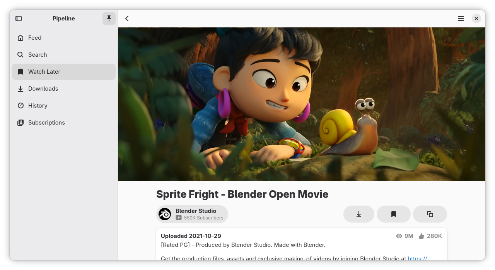

 <h1>📽 Pipeline</h1>
 <strong>Follow your favorite video creators</strong>

 

  
  
  
 

 
Pipeline lets you watch and download videos from YouTube and PeerTube, all without needing to navigate through different websites. Its adaptive design allows you to enjoy content on any screen size.

## Installation

<table>
  <tr>
    <td>Flatpak</td>
    <td>
      
    </td>
  </tr>
</table>

## Features

- Search for you favorite channels and subscribe to them.
- Aggregate videos from all subscriptions into a single feed
- Filter out unwanted items from the feed, like short videos or videos from a series.
- Play those videos either in the built-in video player or with any other video player of your choice.
- Download videos for offline viewing.
- Manage videos you want to watch later.
- Import subscriptions from [NewPipe](https://github.com/TeamNewPipe/NewPipe/) or YouTube
- Multiple platforms:
    - YouTube (using Piped as the backend to prevent throttling)
    - PeerTube
    - suggest any other platform with a good API and it will be considered

## Contributing

See the [Contributing page](CONTRIBUTING.md).

## Translation

Pipeline can easily be translated for other languages, as it uses gettext. Please consider contributing translations using [Weblate](https://hosted.weblate.org/engage/schmiddi-on-mobile/), as an alternative you can also open merge requests and I will notify you if updates are necessary. Thanks to Weblate for free hosting and all the translators for their great work keeping the translations up-to-date.

## Wiki

Please also take a look at the [wiki](https://gitlab.com/schmiddi-on-mobile/pipeline/-/wikis/home) for more information on how to use the app.

## Code of Conduct

This project follows [GNOME's Code of Conduct](https://conduct.gnome.org/).
